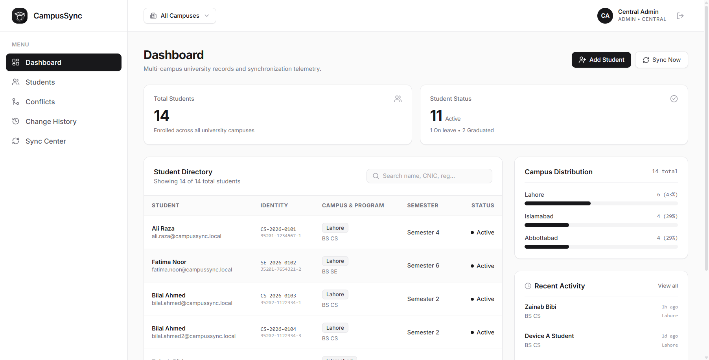
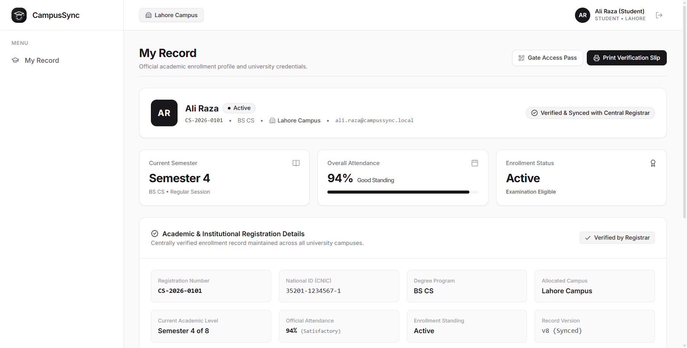
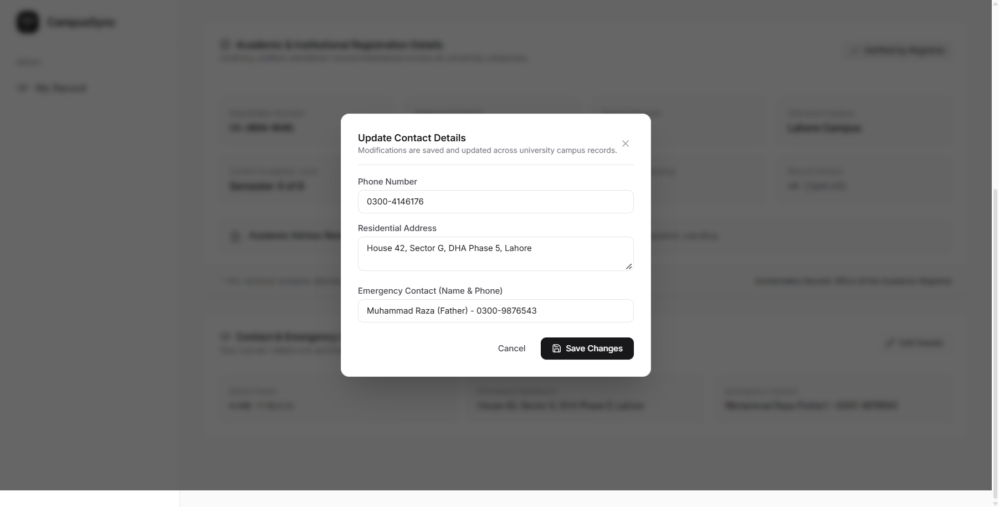
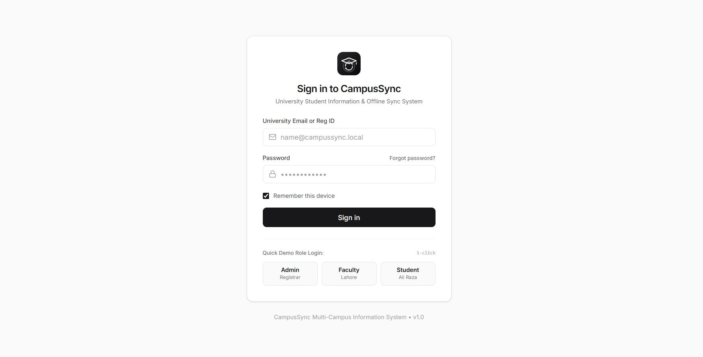
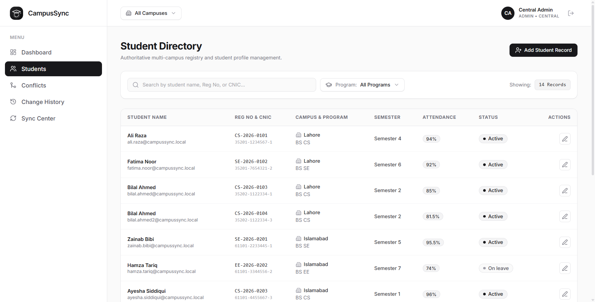
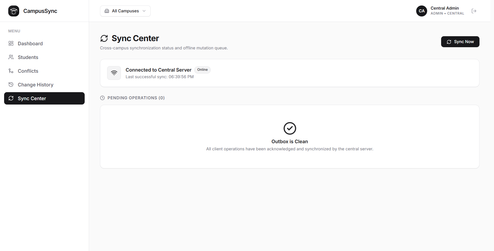
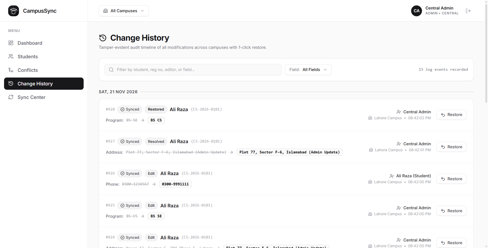
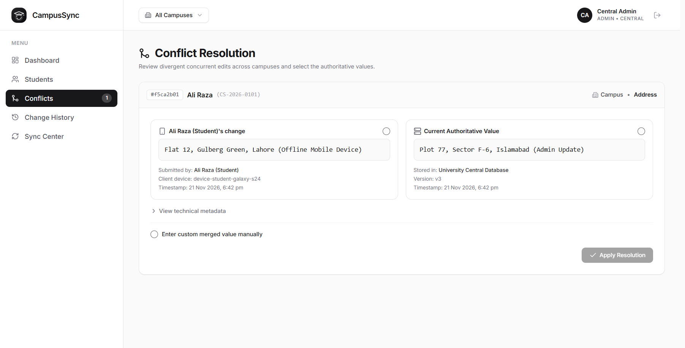
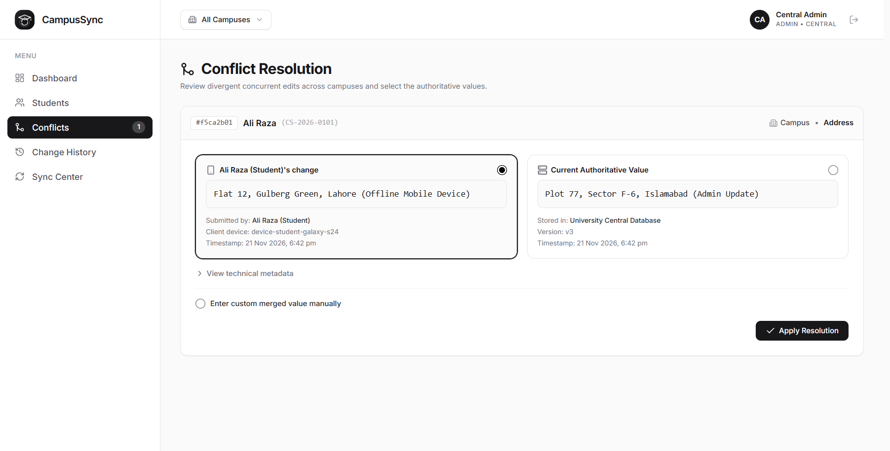
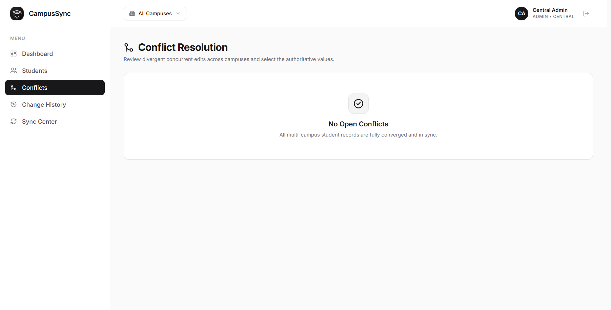

# CampusSync

[](https://github.com/saimsajjid/campussync/actions/workflows/ci.yml)
[](https://www.typescriptlang.org/)
[](https://nodejs.org/)
[](https://www.postgresql.org/)
[](https://web.dev/progressive-web-apps/)
[](LICENSE)

An offline-first student information system for multi-campus universities. Built with deterministic field-level synchronization, idempotent retry queues, 3-way conflict resolution, and an append-only audit ledger backed by PostgreSQL row locks.

- **Production Deployment:** [https://campussync.ourfabrica.com](https://campussync.ourfabrica.com)
- **Fallback Mirror:** [https://150.136.103.208.sslip.io](https://150.136.103.208.sslip.io)

---



---

## The Problem

Universities operating multiple distributed campuses (e.g., Lahore, Islamabad, Abbottabad) face data divergence when wide-area network connections drop or experience intermittent latency:

- An admissions coordinator in Lahore updates a student's contact number while operating offline.
- Simultaneously, a central registrar in Islamabad updates that same student's academic standing online.
- In conventional systems using full-record updates or last-write-wins (LWW) timestamps, one update silently overwrites the other.
- When network interruptions occur in flight, client retries often duplicate records or desynchronize sequence counters.
- Direct database updates erase intermediate transition history, making audit compliance impossible.

CampusSync resolves these distributed systems challenges using an IndexedDB outbox queue, per-field version vectors, PostgreSQL row serialization locks, and an append-only audit ledger.

---

## Architectural Principles

```
[ Browser Client (PWA) ]
  │
  ├─► User Input
  │      │
  │      ▼
  ├─► IndexedDB Outbox (Dexie.js) ──► Optimistic Local UI ("Saved on this device")
  │      │
  │   (HTTP POST /sync/push with RFC4122 opId)
  │      │
  ▼      ▼
[ Fastify Node.js API ]
  │
  ├─► Processed Ops Registry ──► Duplicate opId? Return cached response (Idempotency)
  │
  ├─► PostgreSQL Atomic Transaction:
  │      ├─ 1. SELECT ... FOR UPDATE (Row serialization lock)
  │      ├─ 2. Compare incoming baseVersion with field_versions[field]
  │      │       ├─ Match: Update specific column, increment field version
  │      │       └─ Clash: Write payload to `conflicts` quarantine table
  │      ├─ 3. INSERT INTO history (Immutable audit ledger entry)
  │      └─ 4. Increment global cursor
  │
  └─► Server-Sent Events (SSE) ──► Broadcast cursor to all connected campus nodes
```

1. **Offline-First Outbox Pattern:** All mutations write first to client storage in IndexedDB (`db.outbox`). Edits are tagged with an RFC4122 v4 UUID (`opId`), local `baseVersion`, timestamp, and actor identity. Work remains safe across page reloads and browser restarts.
2. **Idempotency & Lost ACK Recovery:** Solves the Two Generals problem: if the server commits a change but the network drops the return response, the client retries with the original `opId`. The server detects the processed operation in `processed_ops` and returns the cached result without reapplying mutations.
3. **Field-Level Granularity & Auto-Merge:** Record versions are tracked per field (`field_versions JSONB`). Edits targeting disjoint fields (such as phone number and degree program) auto-merge cleanly. Open conflicts only arise when concurrent updates target the exact same field.
4. **Non-Destructive 3-Way Conflict Quarantine:** Conflicting updates are never silently overwritten. Conflicted payloads move to a dedicated `conflicts` table. Operators review the client proposal alongside the current server state with actor provenance and device telemetry.
5. **Immutable Append-Only Ledger:** Historical transitions write to an immutable `history` table. Database triggers disallow `UPDATE` and `DELETE` commands, guaranteeing audit integrity. Rollbacks append a forward-moving transition rather than rewriting past records.

---

## Live Demo & Evaluation Guide

The live deployment at [campussync.ourfabrica.com](https://campussync.ourfabrica.com) is pre-configured for evaluation.

### Pre-Seeded Accounts (Password: `password123`)

| Role | Email | Campus Scope | Permissions |
|---|---|---|---|
| **Central Admin** | `admin@campussync.local` | All Campuses | Read/write across all campuses, resolve open conflicts, restore historical audit states |
| **Faculty (Lahore)** | `faculty.lahore@campussync.local` | Lahore | View campus student roster, edit academic records (attendance, GPA, academic status) |
| **Student** | `student@campussync.local` | Lahore | View student self-service portal, access digital gate pass, edit personal contact details |

### Verification Walkthrough

1. **Sign In:** Open [campussync.ourfabrica.com](https://campussync.ourfabrica.com) and click the **Central Admin** quick-login button.
2. **Simulate Network Outage:** In your browser (Chrome DevTools > **Network** tab), toggle the connection to **Offline** (or disconnect Wi-Fi).
3. **Submit an Edit Offline:** Navigate to **Students**, click **Edit** on student "Ali Raza", update the residential address, and save.
   - The UI updates immediately on the client.
   - The navigation menu displays `1 pending` and the record status reflects `Saved on this device`.
4. **Verify Offline Durability:** Refresh the browser tab (Ctrl+Shift+R or in an incognito window). The Progressive Web App rehydrates from IndexedDB without network connectivity; the queued edit persists in the outbox.
5. **Restore Connectivity:** Set DevTools back to **Online** (or re-enable Wi-Fi). The outbox worker pushes the queued mutation, the server confirms sequence ordering, and the badge transitions to `Synced`.
6. **Inspect the Audit Trail:** Open **Change History** to view the newly committed record with timestamp, actor attribution, before/after strikethrough diffs, and the 1-click **Restore** button.
7. **Inspect Conflict Quarantine:** Navigate to **Conflicts** to observe how concurrent modifications are isolated with full device origin and actor details for 1-click resolution.

---

## Application Screenshots & Feature Walkthrough

All screenshots reflect the live software (`docs/screenshots/`):

| # | Screen | Description |
|---|---|---|
| **01** | **Student Self-Service Portal**<br> | Dedicated student view displaying verified enrollment standing, 94% attendance tracking, central registrar sync badge, digital gate access pass, and print verification slips. |
| **02** | **Contact Details Edit Modal**<br> | Fine-grained contact modification enforcing least-privilege role boundaries. Institutional academic fields remain locked while phone and address edits queue directly to IndexedDB. |
| **03** | **Login & Role Switcher Gateway**<br> | Authentication gateway providing 1-click role cards for Central Admin, Faculty (Lahore), and Student personas. |
| **04** | **Central Admin Multi-Campus Dashboard**<br> | Administrative operations console with real-time SSE connection health, outbox queue counter (`0 pending`), active conflict alerts, and student directory overview. |
| **05** | **Cross-Campus Student Directory**<br> | Multi-campus student registry supporting campus filtering (Lahore, Islamabad, Abbottabad), real-time search, national CNIC verification, and client-visible version numbers (`v1`, `v2`). |
| **06** | **Sync Center & Outbox Telemetry**<br> | Client storage monitor tracking hardware device ID (`Device A`), connection heartbeat intervals, and outbox queue drainage status (`Outbox is Clean`). |
| **07** | **Append-Only Change History**<br> | Chronological audit ledger displaying mutation event sequence numbers (#928, #927, #926, #925), actor attribution, campus tags, strikethrough diffs, and 1-click rollbacks. |
| **08** | **3-Way Conflict Quarantine**<br> | Non-destructive conflict isolation comparing competing offline student edit against server authoritative edit with actor and device provenance (`device-student-galaxy-s24`). |
| **09** | **Active Conflict Resolution**<br> | Interactive resolution view enabling authorized administrators to select the preferred field proposal and commit the resolution. |
| **10** | **System-Wide Convergence**<br> | Clean post-resolution state confirming zero open conflicts across all campuses after resolution broadcasts over SSE. |

---

## Role-Based Access Control (RBAC)

| Data Category | Monitored Fields | Student Scope | Faculty Scope | Central Admin Scope |
|---|---|---|---|---|
| **Identity & Natural Keys** | Name, CNIC, Reg No, Campus | Read Only | Read Only | Full Edit |
| **Academic Records** | Program, Semester, CGPA, Attendance, Status | Read Only | Edit (Own Campus Only) | Full Edit |
| **Contact Details** | Phone Number, Residential Address | Edit (Own Profile) | Read Only | Full Edit |
| **Administrative Operations** | Conflict Resolution, History Rollback | Denied | Denied | Permitted |

---

## Tech Stack

| Component | Technologies | Purpose |
|---|---|---|
| **Frontend** | React 18, Vite 6, Tailwind CSS | Single-page application using custom monochrome design tokens for clear readability and high contrast. |
| **Client Storage** | Dexie.js (IndexedDB) | Client-side outbox queue and local record storage for offline hydration. |
| **Offline Engine** | Vite PWA, Workbox | Service Worker caching enabling the app to boot and run without active network connectivity. |
| **Backend API** | Fastify (Node.js 20 LTS) | Asynchronous REST endpoints and Server-Sent Events (SSE) cursor streaming. |
| **Database** | PostgreSQL 16 Alpine | Row-level locking (`SELECT ... FOR UPDATE`), JSONB version maps, and append-only database triggers. |
| **Validation** | Zod, TypeScript 5.7 | Shared runtime schema validation and static types across client and server. |
| **Deployment** | Docker, Docker Compose | Multi-stage container builds ensuring identical runtime environments. |

---

## Local Setup Guide

### Option 1: Docker Compose (Recommended)

Requires Docker and Docker Compose:

```bash
git clone https://github.com/saimsajjid/campussync.git
cd campussync
docker compose up -d
```

- Web Application: [http://localhost:3050](http://localhost:3050)
- PostgreSQL Port: `localhost:5432` (User: `campussync`, Password: `change-me`, Database: `campussync`)

The container automatically applies migrations, seeds demo accounts, and serves the production frontend.

### Option 2: Bare Metal Development

Requires Node.js 20+ and a local PostgreSQL 16 database:

```bash
# 1. Install dependencies across packages
npm install
npm --prefix shared install
npm --prefix shared run build
npm --prefix server install
npm --prefix web install

# 2. Configure environment
cp .env.example .env

# 3. Run database migrations and seed initial data
npm run db:migrate --prefix server
npm run db:seed --prefix server

# 4. Start backend and frontend services
npm run dev --prefix server   # Starts Fastify API on http://localhost:3050
npm run dev --prefix web      # Starts Vite PWA on http://localhost:5173
```

---

## Automated Test Suites

CampusSync includes automated test suites covering pure sync logic, schema validation, and integration flows:

```bash
# 1. Pure Sync Engine Unit Tests (Outbox FIFO ordering, backoff calculation, idempotency)
npm test

# 2. Shared Validation & RBAC Matrix Tests (CNIC regex, semester limits, role scopes)
npm run test --prefix shared

# 3. End-to-End Integration Test Suite (50+ automated scenarios)
TEST_BASE_URL=http://localhost:3050 npx tsx scripts/test-plan-suite.ts
```

---

## Project Repository & Deployment

- **Author:** Saim Sajid  
- **Repository:** [https://github.com/saimsajjid/campussync](https://github.com/saimsajjid/campussync)  
- **Production URL:** [https://campussync.ourfabrica.com](https://campussync.ourfabrica.com)
